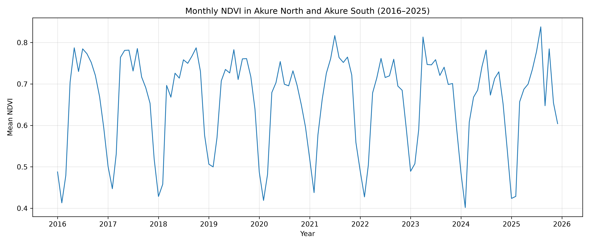
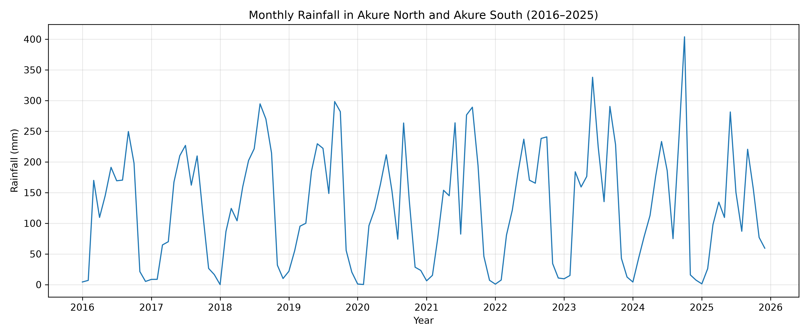
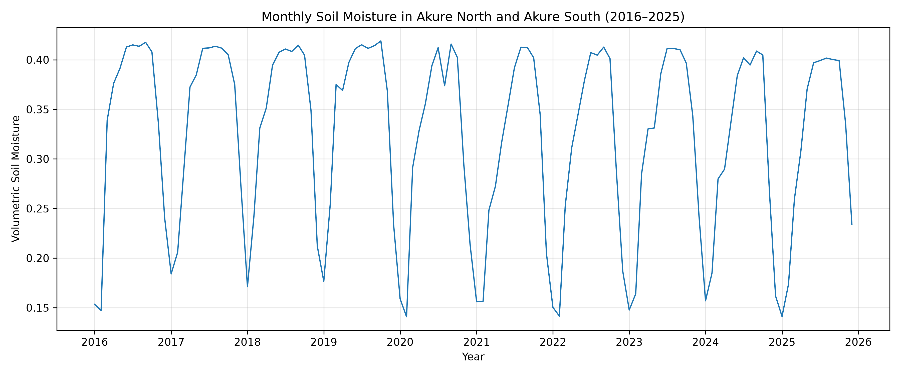
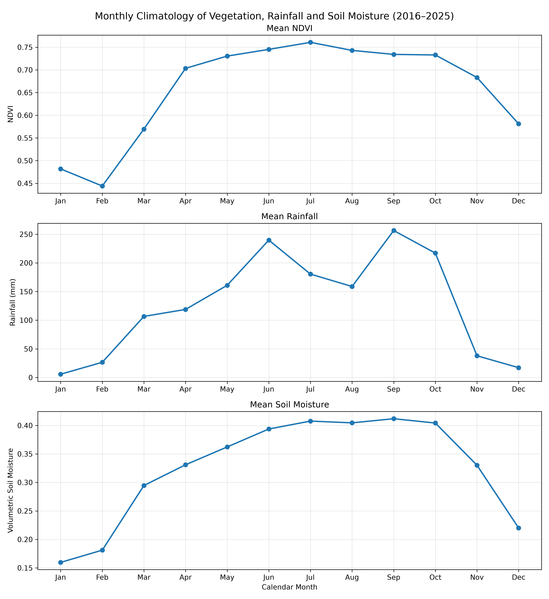
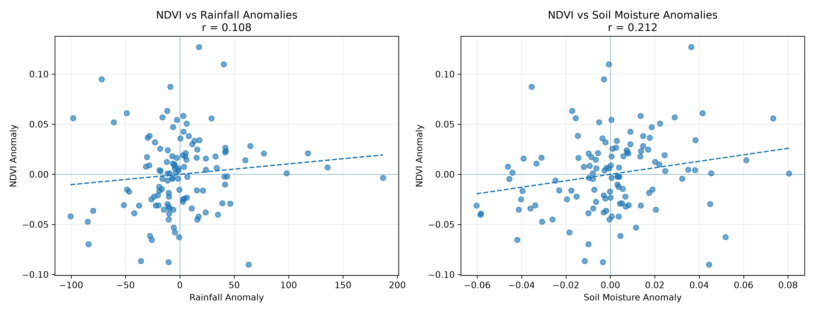
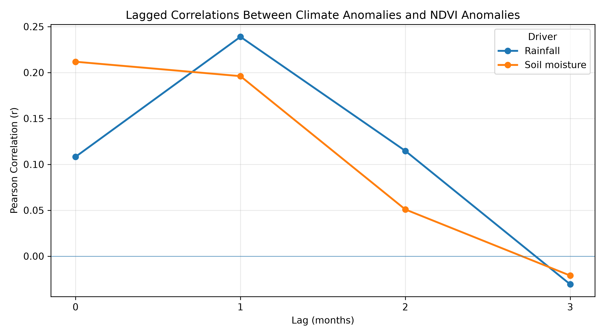

# Vegetation Dynamics and Their Relationship with Rainfall and Soil Moisture in Akure North and Akure South, Ondo State, Nigeria (2016–2025)

## 1. Introduction

Vegetation dynamics are influenced by climatic and environmental conditions, particularly rainfall and soil moisture. Understanding how these factors relate to vegetation conditions can provide useful information for environmental monitoring and land management.

This project examines vegetation dynamics in Akure North and Akure South, Ondo State, Nigeria, from January 2016 to December 2025. It uses satellite-derived Normalized Difference Vegetation Index (NDVI), rainfall estimates, and soil moisture data to investigate their monthly relationships over the ten-year study period.

The analysis was conducted using Google Earth Engine (GEE), with additional statistical calculations and visualisations performed using exported CSV datasets and Python.

## **Key Findings**

- Raw monthly NDVI and soil moisture were strongly positively correlated (r = 0.885).

- After removing the average seasonal pattern, the NDVI–soil moisture anomaly correlation weakened to r = 0.212.

- None of the three primary anomaly correlations passed the Bonferroni-adjusted significance threshold of 0.01667.

- Rainfall anomalies showed a weak positive association with NDVI anomalies at a one-month lag (r = 0.239, p = 0.0089), but this did not pass the adjusted significance threshold of 0.00625.

- Monthly mean NDVI was lowest in February (approximately 0.444) and highest in July (approximately 0.761).

- Rainfall showed relatively high monthly values in June and September, with a decline in July and August.
  
## 2. Study Area

The study covers two Local Government Areas (LGAs) in Ondo State, southwestern Nigeria:

- Akure North
- Akure South

The combined study area is approximately **1,010.40 km²**.

The study area was obtained from the FAO Global Administrative Unit Layers (GAUL) 2015 Level 2 dataset.

## 3. Aim and Objectives

### Aim

To examine vegetation dynamics and their relationships with rainfall and soil moisture in Akure North and Akure South between 2016 and 2025.

### Objectives

1. Analyse monthly vegetation conditions using MODIS NDVI data.
2. Examine monthly rainfall patterns using CHIRPS precipitation data.
3. Examine monthly soil moisture patterns using ERA5-Land data.
4. Investigate the relationships between NDVI, rainfall, and soil moisture using Pearson correlation.
5. Examine seasonality-adjusted relationships using monthly anomalies.
6. Explore possible lagged relationships between rainfall, soil moisture, and NDVI anomalies.

## 4. Datasets

Three remotely sensed and climate-related datasets were used.

| Dataset | Variable | Spatial resolution | Purpose |
|---|---|---|---|
| MODIS MOD13Q1 | NDVI | 250 m | Vegetation monitoring |
| CHIRPS Daily | Precipitation | Approximately 5.5 km | Rainfall estimation |
| ERA5-Land Monthly Aggregated | Volumetric soil water layer 1 | Approximately 11 km | Soil moisture estimation |

### 4.1 MODIS NDVI

The MODIS MOD13Q1 vegetation index product provides NDVI observations at 250 m spatial resolution every 16 days.

The NDVI quality information was used to filter observations, retaining pixels with SummaryQA values less than or equal to 1. The NDVI scale factor of 0.0001 was applied.

### 4.2 CHIRPS Rainfall

CHIRPS Daily precipitation data were used to estimate rainfall.

Daily precipitation values were aggregated into monthly rainfall totals.

### 4.3 ERA5-Land Soil Moisture

ERA5-Land Monthly Aggregated data were used to obtain volumetric soil water content for layer 1, representing the upper 0–7 cm of soil.

This dataset is a model-based reanalysis product rather than direct field measurements.

## 5. Tools and Technologies

The following tools and technologies were used:

- **Google Earth Engine:** Data acquisition, filtering, processing, and analysis.
- **JavaScript:** Google Earth Engine scripting.
- **Python:** Chart generation and visualisation.
- **Pandas:** CSV data handling and processing.
- **Matplotlib:** Statistical charts and visualisation.
- **CSV:** Storage and organisation of monthly datasets and statistical results.
- **Git and GitHub:** Version control, project organisation, and documentation.

## 6. Methodology

### 6.1 Study Period

The analysis covers January 2016 to December 2025, providing 120 monthly observations.

### 6.2 Data Processing

The three datasets were processed within Google Earth Engine.

- MODIS NDVI observations were quality-filtered and converted using the appropriate scale factor.
- CHIRPS daily precipitation observations were summed to obtain monthly rainfall totals.
- ERA5-Land monthly soil moisture values were extracted for the study area.
- Monthly regional mean values were calculated for each variable.

The monthly datasets were combined using their corresponding year and month.

### **6.3 Monthly Climatology and Anomalies**

Calendar-month climatologies were calculated using the average value for each calendar month across the 2016–2025 study period.

Monthly anomalies were then calculated by subtracting the corresponding calendar-month climatology from each monthly observation.

**Anomaly = Observed value − Mean of that calendar month across 2016–2025**

This approach removes the average seasonal pattern and allows the analysis to examine variations relative to the usual conditions for each month.

Each calendar-month climatological mean is based on ten observations, one for each year in the study period.

### 6.4 Pearson Correlation Analysis

Pearson correlation was used to examine the relationships between:

- NDVI and rainfall.
- NDVI and soil moisture.
- Rainfall and soil moisture.

The analysis was performed on both raw monthly values and seasonality-adjusted anomalies.

Two-sided Pearson correlation p-values were calculated for the relationships.

### 6.5 Lagged Anomaly Correlation Analysis

An exploratory lagged correlation analysis was conducted to investigate whether rainfall and soil moisture anomalies were associated with NDVI anomalies in subsequent months.

Lags of 0, 1, 2, and 3 months were examined.

The analysis compared rainfall or soil moisture anomalies at month \(t-k\) with NDVI anomalies at month \(t\), where \(k\) represents the lag in months.

Bonferroni correction was applied separately to the three primary anomaly correlations and the eight lagged comparisons.

- Primary anomaly correlations: \(0.05/3 = 0.01667\).
- Lagged comparisons: \(0.05/8 = 0.00625\).

## 7. Results

### 7.1 Data Processing Summary

| Processing check | Result |
|---|---:|
| Selected LGAs | 2 |
| Combined study area | 1,010.40 km² |
| MODIS 16-day image count | 230 |
| MODIS monthly image count | 120 |
| CHIRPS daily image count | 3,653 |
| CHIRPS monthly image count | 120 |
| ERA5-Land monthly image count | 120 |
| Monthly records | 120 |
| Valid monthly records | 120 |

### 7.2 Raw Monthly Correlations

The raw monthly data showed positive correlations among all three variables.

| Relationship | Pearson r | p-value |
|---|---:|---:|
| NDVI and rainfall | 0.698 | 7.93 × 10⁻¹⁹ |
| NDVI and soil moisture | 0.885 | 4.58 × 10⁻⁴¹ |
| Rainfall and soil moisture | 0.789 | 9.41 × 10⁻²⁷ |

NDVI and soil moisture had the strongest raw monthly correlation, followed by rainfall and soil moisture.

However, these correlations include the influence of seasonal patterns shared by the variables.

### 7.3 Seasonality-Adjusted Anomaly Correlations

After removing the average calendar-month seasonal pattern, the correlations became considerably weaker.

| Relationship | Pearson r | p-value |
|---|---:|---:|
| NDVI and rainfall anomalies | 0.108 | 0.239 |
| NDVI and soil moisture anomalies | 0.212 | 0.020 |
| Rainfall and soil moisture anomalies | 0.138 | 0.132 |

All three anomaly correlations were positive but weak.

None passed the Bonferroni-adjusted significance threshold of 0.01667.

### 7.4 Lagged Anomaly Correlations

The lagged analysis produced the following results.

| Driver | Lag (months) | Observations | Pearson r | p-value |
|---|---:|---:|---:|---:|
| Rainfall anomaly | 0 | 120 | 0.108 | 0.239 |
| Rainfall anomaly | 1 | 119 | 0.239 | 0.0089 |
| Rainfall anomaly | 2 | 118 | 0.115 | 0.216 |
| Rainfall anomaly | 3 | 117 | -0.031 | 0.743 |
| Soil moisture anomaly | 0 | 120 | 0.212 | 0.020 |
| Soil moisture anomaly | 1 | 119 | 0.196 | 0.033 |
| Soil moisture anomaly | 2 | 118 | 0.051 | 0.584 |
| Soil moisture anomaly | 3 | 117 | -0.021 | 0.821 |

The strongest lagged relationship was observed between rainfall anomalies and NDVI anomalies at a one-month lag (\(r = 0.239\), \(p = 0.0089\)).

However, this result did not pass the Bonferroni-adjusted threshold of 0.00625.

The lagged relationships should therefore be interpreted as exploratory findings rather than conclusive evidence.

## 8. Discussion

The raw monthly correlations indicate strong positive relationships between vegetation conditions, rainfall, and soil moisture over the study period. However, these relationships weakened considerably after removing the average seasonal pattern.

This suggests that shared seasonal variation accounts for an important part of the strong correlations observed in the raw monthly data.

The seasonality-adjusted analysis showed weak positive relationships between NDVI anomalies and both rainfall and soil moisture anomalies. However, none of the three primary anomaly correlations passed the Bonferroni-adjusted significance threshold.

The lagged analysis identified a positive relationship between rainfall anomalies and NDVI anomalies at a one-month lag. Nevertheless, this relationship did not pass the adjusted significance threshold for multiple comparisons.

These findings suggest that examining seasonal patterns separately from monthly anomalies provides a more cautious understanding of the relationships between vegetation conditions, rainfall, and soil moisture.

## 9. Limitations

The following limitations should be considered when interpreting the results:

1. **Spatial resolution:** MODIS, CHIRPS, and ERA5-Land have different spatial resolutions, which may influence comparisons between the datasets.
2. **Soil moisture estimates:** ERA5-Land provides model-based reanalysis estimates rather than direct field measurements.
3. **Vegetation index:** NDVI indicates vegetation greenness but does not directly measure crop yield, biomass, or plant health.
4. **Temporal autocorrelation:** The Pearson correlation p-values do not account for temporal autocorrelation in monthly observations.
5. **Multiple comparisons:** Bonferroni correction was applied to the primary anomaly correlations and lagged comparisons, but the analysis remains exploratory.
6. **Spatial aggregation:** Regional mean values may conceal local differences in vegetation, rainfall, and soil moisture within the two LGAs.
7. **Causation:** Correlation does not establish causation. The observed relationships should not be interpreted as proof that rainfall or soil moisture directly caused changes in NDVI.

## 10. Conclusion

This project examined vegetation dynamics and their relationships with rainfall and soil moisture in Akure North and Akure South, Ondo State, from 2016 to 2025.

The raw monthly analysis showed strong positive correlations among NDVI, rainfall, and soil moisture. However, these relationships became considerably weaker after removing the average calendar-month seasonal pattern.

The anomaly analysis revealed weak positive relationships between NDVI and rainfall anomalies and between NDVI and soil moisture anomalies. None of the three primary anomaly correlations passed the Bonferroni-adjusted significance threshold.

The exploratory lagged analysis identified a positive one-month rainfall relationship with NDVI anomalies, but this result also did not pass the adjusted threshold for multiple comparisons.

Overall, the findings demonstrate the importance of accounting for seasonality when examining relationships between vegetation conditions and climatic variables using long-term satellite and reanalysis datasets.

## 11. Project Outputs and Reproducibility

### 11.1 Google Earth Engine Script

The analysis was conducted using Google Earth Engine.

[View the Akure Vegetation Analysis Script (Shareable Snapshot)](https://code.earthengine.google.com/fbac58cd0d1b67e1b9dbe5856c5c6d04)

### 11.2 Monthly Dataset

[View the monthly NDVI, rainfall, and soil moisture dataset](data/Akure_Monthly_NDVI_Rainfall_SoilMoisture_2016_2025.csv)

### 11.3 Monthly Anomalies

[View the monthly anomaly dataset](data/Akure_Monthly_Anomalies_2016_2025.csv)

### 11.4 Monthly Climatology

[View the monthly climatology dataset](data/Akure_Monthly_Climatology_2016_2025.csv)

### 11.5 Lagged Correlation Results

[View the lagged anomaly correlation results](data/Akure_Lagged_Anomaly_Correlations.csv)

### 11.6 Reproducing the Google Earth Engine Analysis

To reproduce the analysis:

1. Open the Google Earth Engine script using the shareable snapshot link.
2. Review the study area, datasets, and processing steps.
3. Run the script in the Google Earth Engine Code Editor.
4. Allow the export tasks to complete.
5. Download the generated CSV files from Google Drive.

The script exports the results to a Google Drive folder named `GEE_Akure_Research`.

The exported raster products include:

- `Akure_Mean_NDVI_2016_2025`
- `Akure_Mean_Annual_Rainfall_2016_2025`
- `Akure_Mean_Soil_Moisture_2016_2025`

**Note:** The shareable snapshot represents a saved version of the script. If the script is modified, create a new snapshot to share the updated version.

### 11.7 Reproducing the Charts

The Python script generates six charts from the exported CSV datasets.

**Requirements:**

- Python 3
- pandas
- matplotlib

Install the required libraries:

```bash
python -m pip install pandas matplotlib
```

Run the script from the project root directory:

```bash
python scripts/generate_charts.py
```

The generated charts are saved in the `images/` directory.

## 12. Repository Structure

```text
Akure-vegetation-analysis/
│
├── README.md
│
├── scripts/
│   ├── Akure_Monthly_NDVI_Rainfall_Soil_Moisture.js
│   └── generate_charts.py
│
├── data/
│   ├── Akure_Lagged_Anomaly_Correlations.csv
│   ├── Akure_Monthly_Anomalies_2016_2025.csv
│   ├── Akure_Monthly_Climatology_2016_2025.csv
│   └── Akure_Monthly_NDVI_Rainfall_SoilMoisture_2016_2025.csv
│
├── images/
│   ├── 01_monthly_ndvi.png
│   ├── 02_monthly_rainfall.png
│   ├── 03_monthly_soil_moisture.png
│   ├── 04_monthly_climatology.png
│   ├── 05_anomaly_relationships.png
│   └── 06_lagged_correlations.png
│
└── outputs/
```

## 13. Visual Results

### 13.1 Monthly NDVI



### 13.2 Monthly Rainfall



### 13.3 Monthly Soil Moisture



### 13.4 Monthly Climatology



### 13.5 Anomaly Relationships



### 13.6 Lagged Correlations



## 14. Project Summary

This project uses Google Earth Engine and satellite-derived environmental datasets to examine vegetation dynamics and their relationships with rainfall and soil moisture over a ten-year period.

It demonstrates the use of remote sensing, time-series analysis, anomaly calculations, correlation analysis, and data visualisation for environmental monitoring in southwestern Nigeria.
